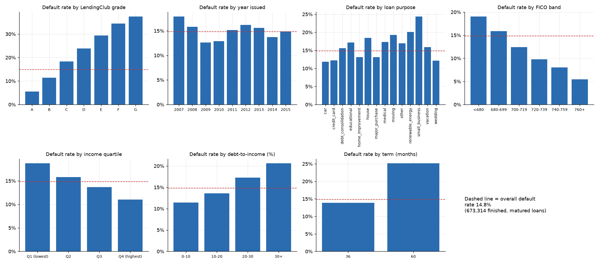
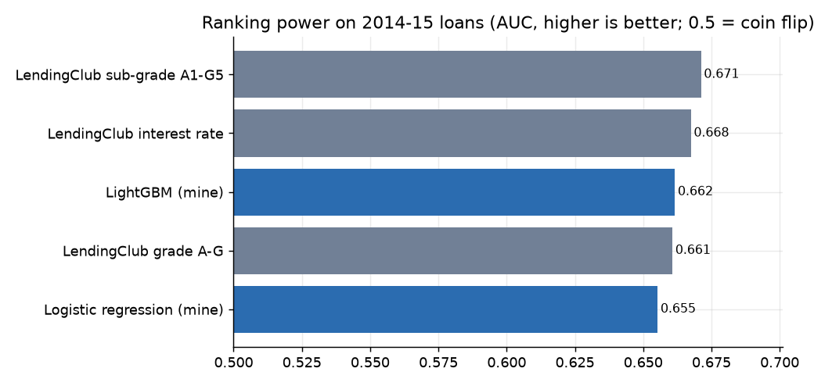
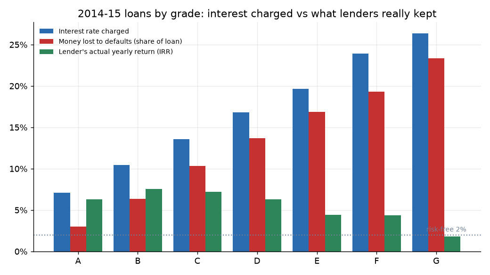
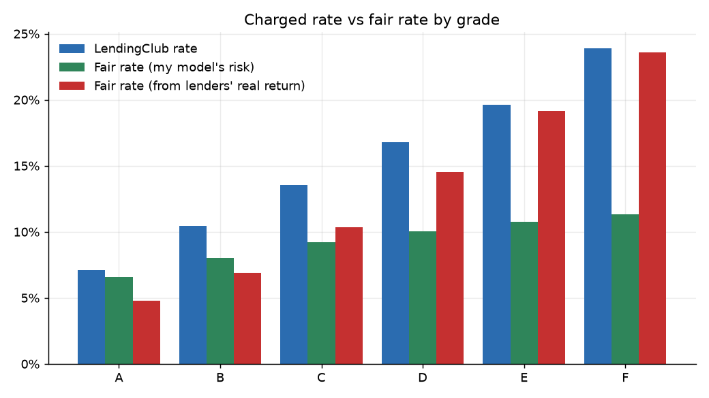
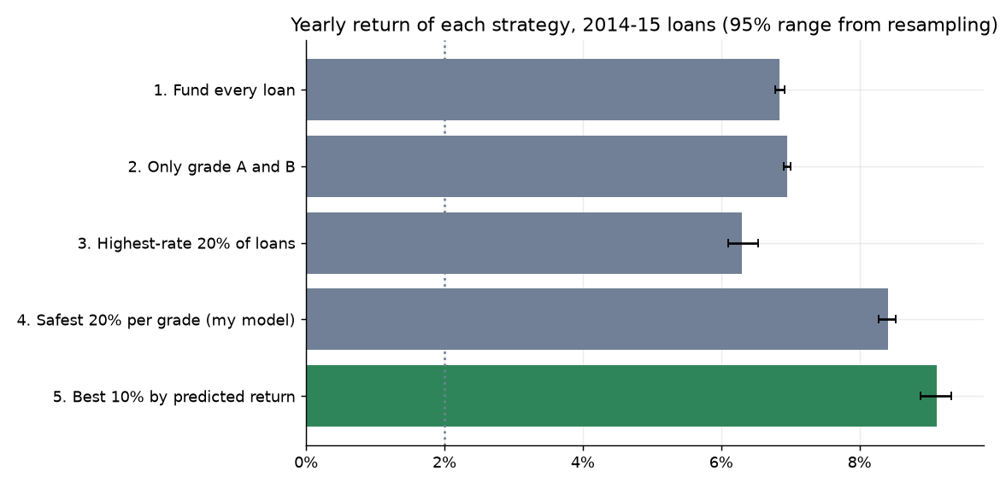
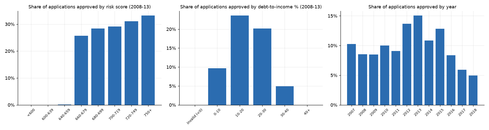

# Does LendingClub Charge Fair Interest? A Test on 2 Million Real Loans

*Reference report (model answer) for the 14-week project. All numbers come from `results/` and can be regenerated with `scripts/run_all.sh`.*

## Abstract

LendingClub sorted borrowers into grades A to G and set interest rates by grade. Using the public record of
2.26 million approved loans and 27.6 million rejected applications (2007-2018), this project asks whether those
rates matched the risk borrowers really posed. A scoring model built from 15 application-time facts ranks default
risk almost as well as LendingClub's grade (AUC 0.662 vs 0.661 for the A-G grade and 0.671 for the finer sub-grade)
and, used together with it, ranks better than either (0.684). Lenders earned 6.3-7.5% a year on grades A-D but
only 4.4% on grades E and F, so the premium LendingClub charged for the riskiest grades was roughly what the defaults
cost, while lower grades paid lenders more than a 4% hurdle. Investors who picked loans with a return-prediction model
trained only on 2007-2013 earned **9.1% a year on 2014-15 loans, against 6.8% for funding every loan**, while chasing the
highest interest rates earned the least (6.3%). Applicants below a risk score of 660 or above 40% debt-to-income were
almost never approved.

## 1. Question

> Does LendingClub charge interest that is fair to each borrower's risk?

Four sub-questions: (1) who fails to repay, (2) can my own scoring machine beat LendingClub's grade, (3) does the
interest paid cover the money lost, and (4) who was turned away?

## 2. Data

LendingClub public dataset (Kaggle, `wordsforthewise/lending-club`): 2,260,701 approved loans (151 fields) and
27,648,741 rejected applications (9 fields), 2007-2018.

Cleaning rules (`src/lc_rates/data.py`):

| Rule | Why |
| --- | --- |
| Keep only *Fully Paid* and *Charged Off* | the outcome is known |
| Keep only loans whose last payment was due by Dec 2018 | otherwise unfinished loans distort the default rate (see Section 6) |
| Keep only single-applicant loans | joint applications have two incomes |
| Drop columns that exist only after the loan ran | using them to predict default is look-ahead cheating |
| Never use grade, sub-grade, interest rate or `installment` as model inputs | they are LendingClub's own answer; `installment` is computed from the rate |

This leaves **673,314 loans** with an overall default rate of 14.8%. Loans issued 2007-2013 (227,957) are the training
set; loans issued 2014-2015 (445,357, all 36-month because 60-month loans from those years had not matured) are the
test set. Loss given default is 55.5%: a defaulting borrower, on average, leaves 55.5% of the amount lent unrecovered.



*Default rises from 5.4% (grade A) to 42% (grade G) in the test years, falls with credit score (19% below 680, 5% above 760)
and with income, and rises with debt-to-income (11% at 0-10% to 21% above 30%). 60-month loans default at 25% against 14% for 36-month loans.*

## 3. Methods

**Inputs (15):** loan amount, term, log income, debt-to-income, FICO score, years in job, credit-card usage, log
card balance, late payments (2 years), credit checks (6 months), public records, open accounts, total accounts, credit
history length, loan-to-income, plus purpose and home ownership.

**Models:** (1) logistic regression, explainable; (2) LightGBM with early stopping on 2013 as a held-out year, then refit
on all training years (152 trees); (3) a LightGBM regressor of each loan's return, used only for investing.
All trained on 2007-2013 only.

**Return** is measured as the yearly internal rate of return (IRR) of a group of loans' pooled cash flows. Profit divided
by amount lent understates it, because borrowers repay principal every month.

**Fair rate** = risk-free rate (2%) + required margin (2%) + yearly expected loss, where
expected loss = probability of default × loss given default, spread over the loan's life and divided by the
average share of principal still outstanding (0.55). It is a teaching formula; Section 4.3 checks it against reality.

## 4. Findings

### 4.1 My machine versus LendingClub

| Score | AUC on 2014-15 loans |
| --- | --- |
| LendingClub sub-grade (A1-G5) | **0.671** |
| LendingClub interest rate | 0.668 |
| **LightGBM (mine)** | 0.662 |
| LendingClub grade (A-G) | 0.661 |
| **Logistic regression (mine)** | 0.655 |
| **Sub-grade + my LightGBM together** | **0.684** (cross-validated) |

AUC is the chance that a randomly chosen defaulter is ranked riskier than a randomly chosen repayer (0.5 = coin flip).
LendingClub's finer sub-grade is slightly better than my model alone, which is expected: it sees credit-bureau detail
that my 15 inputs do not. But the two see different things: **combining them beats either**, so the model adds real information.



**The strongest drivers of risk** (mean |SHAP|): FICO score, loan term (60-month loans are riskier), income, credit
checks in the last 6 months (more checks, more risk), loan-to-income, purpose, debt-to-income, and card usage.

**Where we disagree** (safest/riskiest 30% by each scorer):

| Group | Loans | Actual default | Avg rate | My predicted default |
| --- | --- | --- | --- | --- |
| Both say safe | 84,940 | 4.5% | 7.2% | 5.8% |
| Both say risky | 77,731 | 27.2% | 16.5% | 21.8% |
| LendingClub safe, mine risky | 7,592 | 12.0% | 8.0% | 18.9% |
| LendingClub risky, mine safe | 9,108 | 15.0% | 15.1% | 7.4% |

Where we disagree neither side is right: both over-state, but LendingClub's call on its "risky" group (15.0% vs 15.1% rate)
was close, while the model over-stated risk for borrowers LendingClub liked (18.9% predicted, 12.0% actual).

**Calibration.** The model predicted 13.0% default on average; 14.5% actually defaulted. 36-month loans defaulted
at 12.4% in 2007-13 and 14.5% in 2014-15, so some under-prediction is what forecasting a worsening future looks like.

### 4.2 Does interest cover the losses?

| Grade | Default rate | Interest charged | Lender's real yearly return (IRR) |
| --- | --- | --- | --- |
| A | 5.4% | 7.1% | 6.3% |
| B | 11.5% | 10.4% | **7.5%** |
| C | 18.6% | 13.5% | 7.2% |
| D | 24.7% | 16.8% | 6.3% |
| E | 30.4% | 19.6% | 4.4% |
| F | 34.8% | 23.9% | 4.4% |
| G | 42.1% | 26.4% | 1.8% (423 loans) |

A lender earns far less than the interest rate, because of defaults. Best returns come from grades B and C; grades
E-G barely beat a 4% (risk-free 2% + 2%) hurdle, and grade G does not.



### 4.3 The fair rate



Three views of "fair" disagree, and the disagreement is a finding:

| Grade | Charged | Fair (model's risk) | Fair (from lenders' real return) |
| --- | --- | --- | --- |
| A | 7.1% | 6.6% | 4.8% |
| C | 13.5% | 9.2% | 10.4% |
| E | 19.6% | 10.7% | 19.2% |
| F | 23.9% | 11.3% | 23.6% |

* **Model-based fair rate** says grades E and F are overcharged by 9-13 points. This is **misleading**: the model's
  probabilities are squeezed toward the middle (for grade E it predicts 20% default, but 30% occurred), and the formula
  ignores that defaults come early and also cost the interest that would have followed.
* **Return-based fair rate** (the charged rate moved by how far lenders' real return landed from the 4% hurdle) is more
  trustworthy: grades A-D were charged 2.3-3.5 points more than needed, while E and F were charged about what the defaults cost (within 0.5 points).

By segment (`results/fair_rate_gaps.csv`): lenders earned 6.0% on the lowest-income quartile and 7.5% on the highest, so
income appears to be **under-priced**: low-income borrowers pay about 2.5 points more but default 8 points more often. Across FICO bands, lender returns
are flat (6.5-7.3%), so credit score is priced about right.

### 4.4 Investing strategies

Each strategy picks loans from the 2014-15 test set using information available at the time.

| Strategy | Loans | Yearly return | 95% range | Default rate |
| --- | --- | --- | --- | --- |
| 1. Fund every loan | 445,357 | 6.8% | 6.8-6.9% | 14.5% |
| 2. Only grade A and B | 250,538 | 7.0% | 6.9-7.0% | 8.9% |
| 3. Highest-rate 20% | 89,072 | 6.3% | 6.1-6.5% | 25.3% |
| 4. Safest 20% per grade (my model) | 89,069 | 8.4% | 8.3-8.5% | 9.9% |
| 5. Best 10% by predicted return | 44,536 | **9.1%** | 8.9-9.3% | 17.3% |



* Chasing the highest rates is the **worst** idea: the extra interest is eaten by defaults.
* Picking the best loans *within* each grade, using the model, adds 1.6 points over funding everything.
* The more selective the investor, the higher the return, and the same pattern appears on a held-out year (2013: 13.3% at 10% of loans vs 10.0% for all):

| Share of loans funded | Held-out 2013 | Test 2014-15 |
| --- | --- | --- |
| 5% | 13.8% | 9.8% |
| 10% | 13.3% | 9.1% |
| 20% | 12.6% | 8.5% |
| 50% | 11.3% | 7.7% |
| 100% | 10.0% | 6.8% |

The 10% pool size was fixed in advance (about 44,000 loans keeps the portfolio diversified), not picked because it looked best.
Evidence for an inefficient market is only suggestive: this is one period, ignores fees and taxes, and assumes the chosen loans
could actually have been bought.

### 4.5 Who was turned away?

Only 7.6% of 29.9 million applications were approved. In 2008-2013:

* **Risk score:** 0.2% approved at 640-659; **25.7% at 660-679**; 33% above 750. A near-hard cutoff at 660.
* **Debt-to-income:** 0% approved above 40%; 4.9% at 30-40%; about 24% at 10-20%.
* **Amount:** 7.7% approved for loans over $25k; about 19-20% for $10-25k.
* **States:** approval is 16% in California and Washington but near 0% in a few small states (e.g. Maine, North Dakota), which probably
  reflects where LendingClub could operate, not applicant quality.
* **Approvals fell** from 15.1% in 2013 to 5.0% in 2018.



These are **differences, not causes**: the data cannot show why LendingClub decided.

## 5. Limitations

* The rejected file has **no income**, so approved and rejected applicants cannot be compared on income.
* Risk-score scale changes after 2013 and is missing for much of 2015 and 2018, so score thresholds are only reliable for 2008-2013. The rejected "employment < 1 year" bucket is very large (1.2M of 1.7M), which suggests missing values are coded that way, so employment differences should not be over-read.
* The test set contains only 36-month loans; results for 60-month loans are not tested.
* Return assumes repayments arrive evenly until the last payment; fees and taxes are ignored.
* The fair-rate hurdle (4%) is an assumption; changing it moves every gap, though not their ordering.
* Past results from one period do not predict the future.

## 6. Mistakes I made and how I fixed them

1. **Counting unfinished loans.** Treating "Current" loans as fine made 2018 look like a 1.8% default year. Dropping them without a maturity rule made 2016 look like 23%, because bad loans resolve early while good ones are still running. Fix: keep only loans old enough to be finished (default 13.7% for 2014 loans, 14.9% for 2015).
2. **A silent zero.** A missing "years in job" was converted to 0 years by a one-line pandas bug (`mask` with a missing condition). A unit test caught it; the models were retrained.
3. **Hidden leakage.** `installment` looks innocent but is calculated from the interest rate, so it would give the "independent" model LendingClub's own price. It is excluded and a test enforces it.
4. **Wrong yardstick for return.** Profit divided by amount lent, per year of loan term, gave a flat 2-3% for every grade (A: 2.3%, C: 2.5%, G: 0.5%), hiding the real differences. Lenders get principal back every month, so money is not tied up for the whole term; the right measure is IRR (A: 6.3%, B: 7.5%, C: 7.2%).
5. **Trusting my fair-rate formula.** It said grade F was overcharged by 12 points, but lenders earned only 0.4 points above the hurdle on F. The formula ignores timing and lost interest, so the report now checks it against realised returns.
6. **Only keeping a result that looks good.** The first return model was not judged on a held-out year. The share of loans funded is now fixed in advance and shown across a table of choices, on both a held-out year and the test years.

## 7. Conclusion

LendingClub's grades carried real information and their interest rates were roughly fair at the top of the risk range,
but lower-risk borrowers paid lenders more than a 4% hurdle required and income was under-priced. A scoring model built
by one student from 15 simple facts matched the grade, added information to it, and beat naive investing by 2.3 points a
year in the 2014-15 test, as long as the investor was selective *within* grades and never simply chased the highest rate.

## Appendix: reproduce

```bash
pip install -r requirements-dev.txt
bash scripts/run_all.sh
streamlit run app/streamlit_app.py
```
